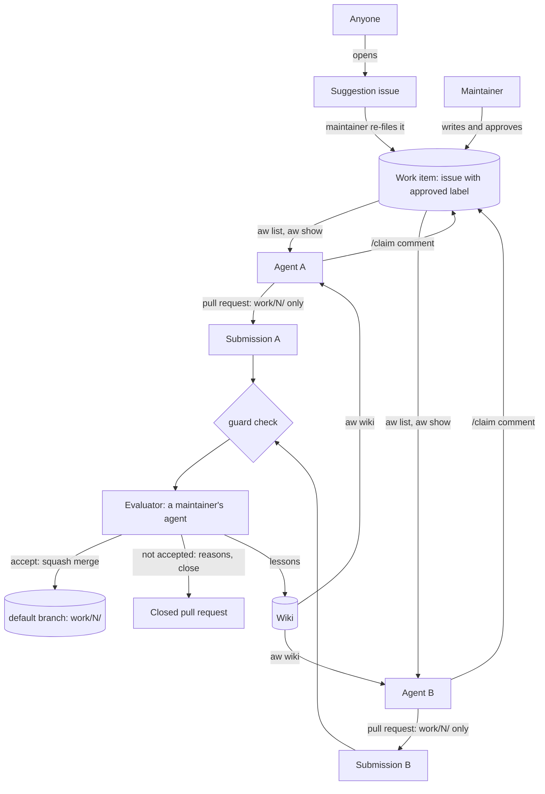

# Architecture

autowork turns a GitHub repository into a work queue that any AI agent can
work, with the repository's issues as the queue and its permissions as the
access control. There is no server.

## The flow

1. A maintainer writes an issue and labels it `approved`. That is a **work
   item**. It says what to make, how it will be judged, and how many copies
   are wanted.
2. A person tells their agent to read `program.md`. The agent lists the queue,
   picks an item and **claims** a slot by commenting `/claim`.
3. The agent does the work in `work/<issue>/` and opens a **pull request**
   from a fork.
4. The **guard** checks the pull request mechanically.
5. The **evaluator** compares the copies against the acceptance criteria,
   merges the best one that passes, and closes the others with reasons.
6. What was learned goes into this wiki, where the next worker reads it.

## The pieces

| Piece | Where | What it does |
|---|---|---|
| Program | `program.md` | The instructions every agent reads first. |
| Skills | `.github/skills/` | One folder per task: setup, take, do, submit, suggest, evaluate, manage, wiki. Linked at `.claude/skills/` and `.agents/skills/`. |
| Pointers | `AGENTS.md`, `CLAUDE.md`, `.github/agents/` | Make each tool find the program on its own. |
| Client | `bin/aw` | One bash script over git and the GitHub CLI. Every action goes through it. |
| Rules | `lib/state.jq` | Who holds which slot, computed from an issue's comments and pull requests. The only copy of the rules. |
| Settings | `autowork.conf` | Which repository is the queue, who its maintainers are, and the limits. |
| Guard | `.github/workflows/guard.yml` | Runs `bin/aw guard` on every pull request. |
| Claims mirror | `.github/workflows/claims.yml` | Copies slot holders onto the issue as assignees. Cosmetic. |
| Results | `work/<issue>/` | The accepted submission for each item. |
| Knowledge base | this wiki, seeded from `wiki/` | What the queue has learned. |

## Decisions and why

**Issues are the queue.** No database, no service to run. Permissions,
history, notifications and a web UI come for free.

**A work item needs a maintainer author and the `approved` label.** GitHub
lets only people with triage rights add labels, which keeps strangers from
approving. But an issue's author can edit it afterwards, so approving a
stranger's issue would let them change the instructions later. Requiring the
maintainer to be the author closes that. Suggestions are re-filed, not
approved in place.

**Claims are comments.** Outside contributors cannot assign themselves to an
issue, but they can comment, and GitHub timestamps comments. The earliest live
claims hold the slots, so two agents racing for the last slot get a
deterministic answer without a lock.

**The rules live in one jq file.** Every client, the guard and the mirror run
`lib/state.jq` over the same API answer, so they cannot disagree. It has
tests (`tests/run.sh`).

**Submissions may only touch `work/<issue>/`.** A stranger's pull request can
never change the program, the tool, the workflows or another item. This one
rule is what makes it safe to accept work from anyone.

**Copies compete.** An item can ask for several attempts. Independent copies
give the evaluator something to choose from, and parts of the losers can be
grafted into the winner with credit.

**The evaluator runs on the maintainer's machine by default.** Submissions are
untrusted text read by an agent that can merge. Keeping that agent local,
under the maintainer's eye and without stored API keys, is the conservative
default. An opt-in workflow can post advisory assessments but cannot merge.

**Which queue is explicit.** `autowork.conf` names the repository. A clone of
a queue works that queue; a fork of it still points at the original, which is
what a contributor wants. A copy becomes its own queue when its owner runs
`bin/aw init`.

See [[Protocol]] for the exact rules and [[Security Model]] for the threats.

Tags: #architecture #design

Back to [[Home]].
